# Install Tab Peek on Safari

Tab Peek isn't on the Mac App Store, so for Safari you build it yourself
with Xcode, Apple's free app for making apps. It takes about 15 minutes
(plus Xcode's download). **You don't need to know how to code.** You only
change a few names so the app is yours.

Using Chrome, Edge, Firefox or Zen instead? See the
[README](README.md#install) for their guides.

## What you need

- A Mac with **macOS 27** or later
- **Xcode**, free from the Mac App Store. It's large, so start the
  download first
- An **Apple ID**: the one you already use is fine. You **don't** need
  the paid Apple Developer Program

---

## 1. Download Tab Peek

1. Go to [github.com/SiddheshDubal/Tab-Peek](https://github.com/SiddheshDubal/Tab-Peek).
2. Click the green **Code** button, then **Download ZIP**.
3. Double-click the downloaded zip to unpack it.
4. Move the unpacked folder to your **home folder** (or anywhere that is
   **not** in iCloud Drive: iCloud syncing can damage Xcode projects).

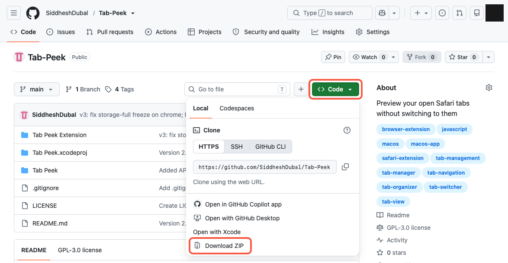

> Use Git? `git clone https://github.com/SiddheshDubal/Tab-Peek.git` works too.

## 2. Add your Apple ID to Xcode

1. Open **Xcode**. If it asks to install extra components, let it.
2. In the menu bar: **Xcode → Settings…**, then **Apple Accounts** in the
   sidebar.
3. Click **Sign In…** and sign in with your Apple ID.

Your account now appears in the list. Xcode gives it a free **Personal
Team**: a signing identity that lets you build apps for your own Mac.

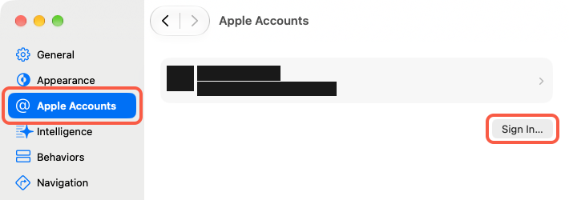

*(In these pictures, black bars hide the author's own name, email and IDs.
You'll see yours there.)*

## 3. Open the project

In the folder from step 1, double-click **`Tab Peek.xcodeproj`**. Then,
in Xcode's left sidebar, click the blue **Tab Peek** icon at the very top.

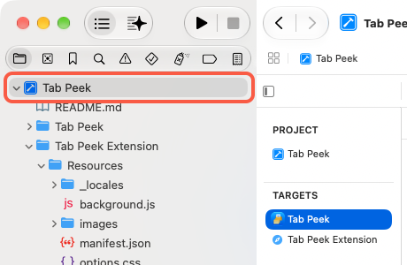

## 4. Make the names your own

Every Mac app has a unique ID, called a **bundle identifier**, written
like a website address backwards. Tab Peek's IDs belong to its author's
Apple account, so Xcode won't let you use them. You choose your own.

Pick one in this shape (letters, numbers, dots and dashes only):

```
com.yourname.Tab-Peek
```

You'll change it in **three places**. They must match exactly.

### 4a. The app

1. In the middle column, under **Targets**, select **Tab Peek**.
2. Open the **Signing & Capabilities** tab.
3. **Team**: choose your name (Personal Team).
4. **Bundle Identifier**: type your ID, e.g. `com.yourname.Tab-Peek`.

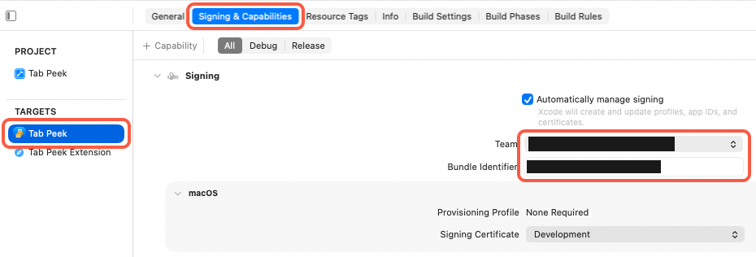

### 4b. The extension

1. Under **Targets**, select **Tab Peek Extension**, same tab.
2. **Team**: your Personal Team again.
3. **Bundle Identifier**: your app ID **plus `.Extension`**, e.g.
   `com.yourname.Tab-Peek.Extension`.

   It **must** start with the app's ID from 4a. The extension lives
   inside the app, and macOS checks that its name starts with the app's.

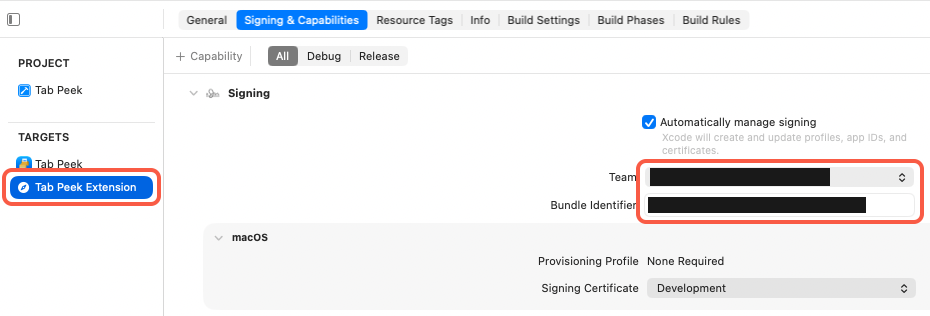

### 4c. Tell the app its extension's new name

1. In the left sidebar, open **Tab Peek → ViewController.swift**.
2. Near the top, find this line:

   ```swift
   let extensionBundleIdentifier = "com.siddheshdubal.Tab-Peek.Extension"
   ```

3. Change only the text **inside the quotes** to your extension ID from
   4b, e.g. `"com.yourname.Tab-Peek.Extension"`.

The app uses this to find its own extension: to say whether it's on or
off, and for its "Quit and Open Safari Settings…" button. If it doesn't
match, the app can't find the extension: it never says "on" or "off"
and the button does nothing (Tab Peek itself still works in Safari).

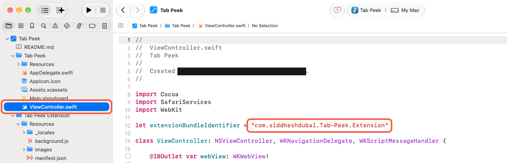

> **Red error under Signing?** Usually your ID is already taken by
> someone else. Make it more unique (e.g. add your surname) in all three
> places.

## 5. Build and install

1. In the menu bar: **Product → Archive**. Xcode builds Tab Peek; when
   it's done, the **Organizer** window opens.

   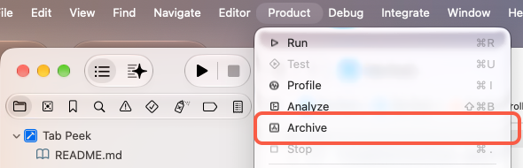

2. Click **Distribute App**, choose **Custom**, click **Next**…

   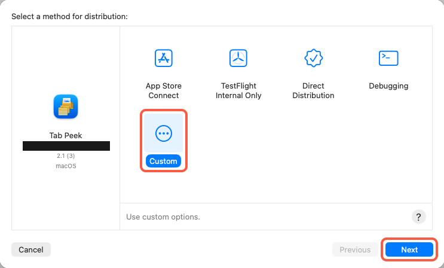

   …then choose **Copy App**, click **Next**, and save it somewhere (e.g.
   your Desktop).

   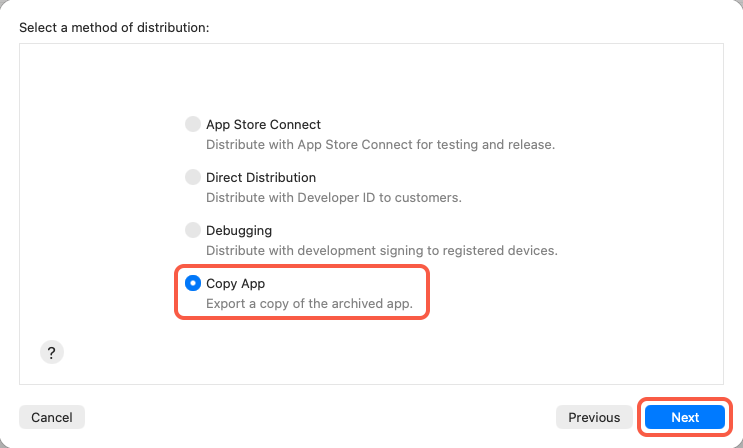

3. In that folder, drag **Tab Peek.app** into your **Applications** folder.
4. Back in Xcode: **Product → Clean Build Folder**. Xcode keeps its own
   copy of the app while building; cleaning removes it so Safari doesn't
   list Tab Peek twice.

> Just trying it out? **Product → Run** (⌘R) also works, but that copy
> lives in Xcode's build folder and disappears when you clean it.

## 6. Turn it on in Safari

1. Open **Tab Peek** from Applications. Its window tells you whether the
   extension is on. Click **Quit and Open Safari Settings…**

   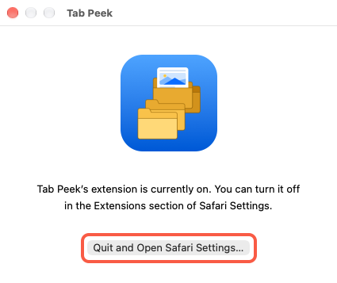

2. In **Safari → Settings → Extensions**, tick **Tab Peek**.

   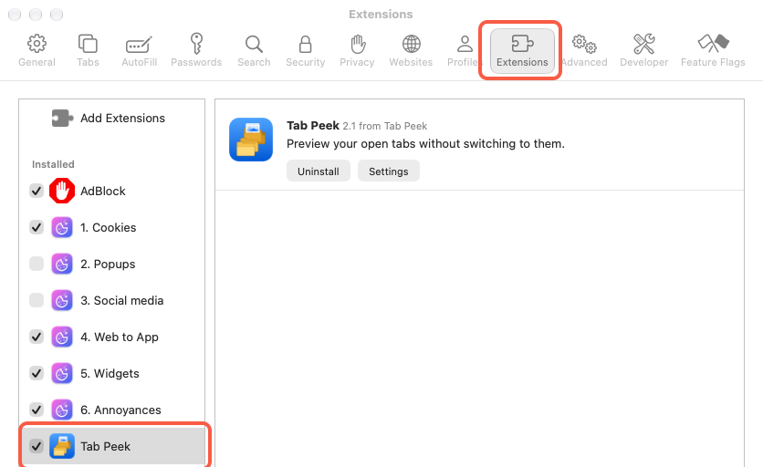

3. Tab Peek asks to read webpages: allow it on **all websites**. It
   needs this to take the previews. **Nothing is ever sent anywhere**: Tab
   Peek makes no network requests, and thumbnails stay on your Mac.
4. The Tab Peek button appears in Safari's toolbar. Switch between a few
   tabs (a preview is saved when a tab is in front for half a second),
   then click it and hover a tab.

   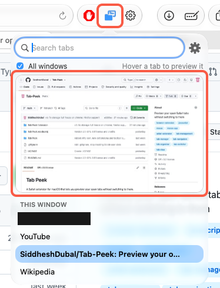

The button is **blue** on normal websites and **grey** on pages where
extensions can't run, like the Start Page. That's Safari, not a bug.

---

## Updating to a new version

Download the new version and repeat steps 3 to 5, using the **same IDs**
as before. Safari keeps your settings and thumbnails.

## Removing Tab Peek

Untick it in Safari → Settings → Extensions, then drag **Tab Peek** from
Applications to the Bin.

## Problems

| What you see | What to do |
|---|---|
| "No signing certificate" or other signing errors | Check step 2, and that **both** targets have your team in step 4 |
| Red error: the bundle identifier isn't available | Pick a more unique ID, in all three places |
| Tab Peek isn't in Safari's Extensions list | Open the Tab Peek app once, then quit and reopen Safari |
| **Two** "Tab Peek" rows in Safari's list | One is Xcode's build copy: do step 5.4, then quit and reopen Safari. Only one of the two actually runs (the one with a **Settings** button) |
| The app window never says "currently on" or "currently off", and its button does nothing | Step 4c's ID doesn't match 4b exactly |
| The popup says "No preview for this tab yet" | That tab hasn't been in front since Tab Peek started. Click it, wait a second, try again |
