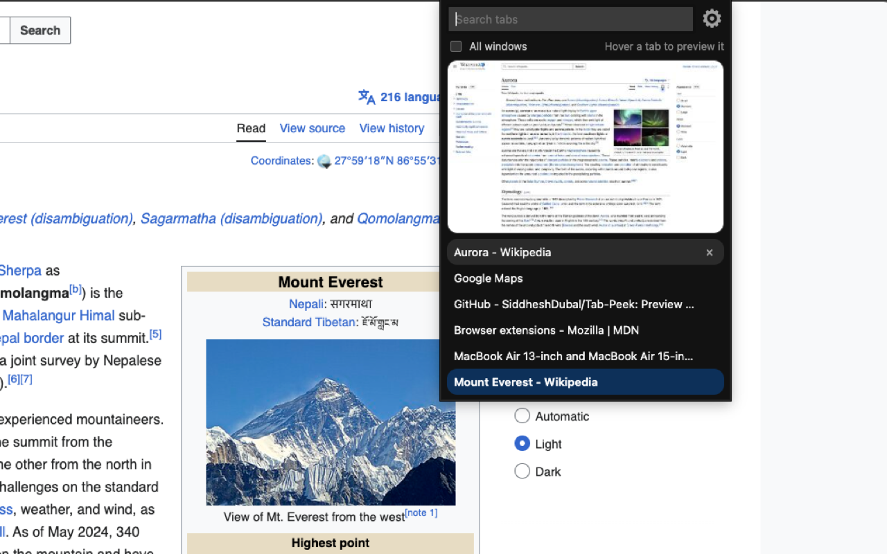
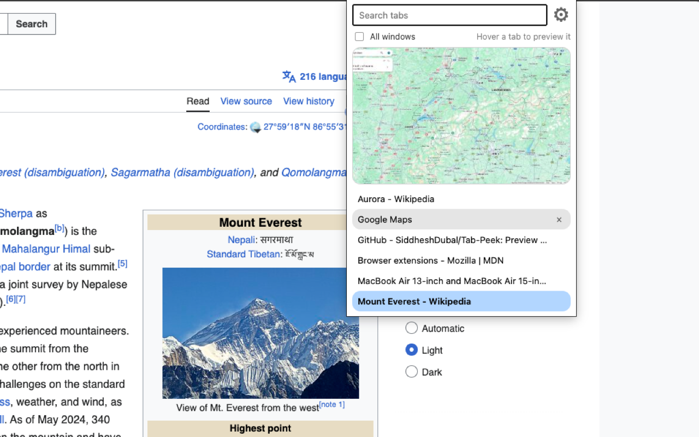

# Tab Peek

A browser extension that lets you preview your open tabs without switching
to them. Works in **Safari, Chrome, Edge, Firefox and Zen**.

## Install

| Browser | How to get it | Guide |
|---|---|---|
| **Firefox, Zen** | Firefox Add-ons store (in review). Until it's live, load it yourself | [INSTALL-FIREFOX.md](INSTALL-FIREFOX.md) |
| **Edge** | Edge Add-ons store (in review). Until it's live, load it yourself | [INSTALL-EDGE.md](INSTALL-EDGE.md) |
| **Chrome, Brave, Vivaldi, Opera, Arc** | Load it yourself from this page (about 2 minutes) | [INSTALL-CHROME.md](INSTALL-CHROME.md) |
| **Safari** (Mac only) | Build it yourself with Xcode (free, about 15 minutes) | [INSTALL-SAFARI.md](INSTALL-SAFARI.md) |

No coding is needed for any of them. Ready-made zips for each browser are
on the [Releases](https://github.com/SiddheshDubal/Tab-Peek/releases) page.

## What it does

- Click the Tab Peek button in your browser's toolbar to see a list of the
  tabs in the current window. The tab you're on is highlighted, and its
  preview is shown when the popup opens.
- Hover a tab in the list to see a thumbnail of that page.
- Type in the search box to filter tabs by title or address.
- Click a tab to switch to it. Click its × to close it.
- Tick **All windows** to list the tabs of every browser window, grouped
  under a header per window. Click another window's header to bring that
  window to the front, or its × to close the whole window (it asks first).
- Click the ⚙ next to the search box to open Tab Peek's settings.

## Settings

Changes are saved as soon as you make them. Each setting has a "?" that
explains it (hover to peek, click to keep it open).

- **Thumbnails**: how many to keep (10–500, default 100), how sharp they are
  (Low / Medium / High), and a button to delete them all.
- **Theme**: Auto (follows your computer's light or dark mode), Light or
  Dark, for the popup and the settings page.
- **Popup**: tab list height, show or hide the preview card, how long to
  hover before a preview appears (0–1000 ms), show or hide the hover hint,
  and whether closing a tab or a window asks first.

Each section has a "Reset to default" button that appears once something in
it has changed, and "Reset all settings to defaults" puts everything back.

Where the settings open depends on the browser: in a tab in Safari, in a
small box over the extensions page in Chrome and Edge, and on Tab Peek's
**Preferences** tab in Firefox and Zen.

## How it works

- **Background script** (`background.js`): when a tab becomes active, or
  finishes loading while active, Tab Peek waits half a second, takes a
  screenshot of it, shrinks it, and saves it on your computer.
- **Toolbar popup** (`popup.html`, `popup.css`, `popup.js`): lists the tabs
  and shows the saved thumbnail when you hover one.
- **Settings page** (`options.html`, `options.css`, `options.js`).
- **Shared code**: `settings.js` holds every setting's default and loads the
  saved values; `theme.js` applies the chosen theme.
- Thumbnails are deleted when a tab or window closes. Tab Peek keeps only the
  newest ones (100 unless you change it), and cleans up leftovers after the
  browser restarts. If the browser's storage fills up, it deletes the oldest
  tenth and tries again.
- One set of files runs everywhere: the manifest lists `service_worker` for
  Chrome, Edge and Safari and `scripts` for Firefox, and each browser uses
  the one it understands.

## Privacy

- Thumbnails and settings are stored only on your computer, in the
  extension's own storage inside your browser.
- Tab Peek makes no network requests. Nothing is uploaded anywhere, and
  there are no analytics.
- Permissions: `tabs` (read tab titles and addresses), `storage` (save
  thumbnails and settings), and access to all websites (required to
  screenshot a page).

## Limitations

- A tab needs to have been in front at least once to have a thumbnail
  (browsers can only screenshot what is on screen). Until then, the popup
  shows "No preview for this tab yet".
- Thumbnails are still images from the last time the tab was visible, not
  live previews.
- The browser's own pages (settings, `chrome://`, `about:` pages) and the
  extension stores can't be captured, so they have no preview.
- Safari's tab groups aren't shown; Safari doesn't give extensions access to
  them.

## Tested on

macOS 27 with Safari 27, Chrome 156, Edge 157, Firefox 159 and Zen.
Windows and Linux should work in Chrome, Edge, Firefox and Zen but haven't
been tested yet.

## Project layout

- `Tab Peek Extension/Resources/`: the extension itself (manifest,
  background script, popup, settings page). This is the folder every
  browser loads.
- `Tab Peek/`: the small Mac app that installs the extension in Safari
- `INSTALL-*.md` and `docs/`: install guides, pictures and screenshots

## License

Copyright (C) 2026 [SiddheshDubal](https://github.com/SiddheshDubal)

Tab Peek is free software, licensed under the GNU General Public License
v3.0. See `LICENSE` for the full text.

**Additional terms (GPL-3.0 section 7(b)):** the settings page shows the
author line "Tab Peek by SiddheshDubal". Any copy or modified version you
share must keep that line in the program's legal notices.

## Version

3.1
